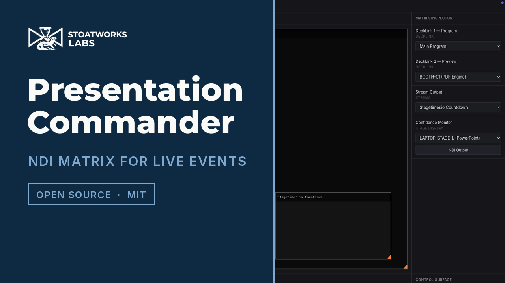
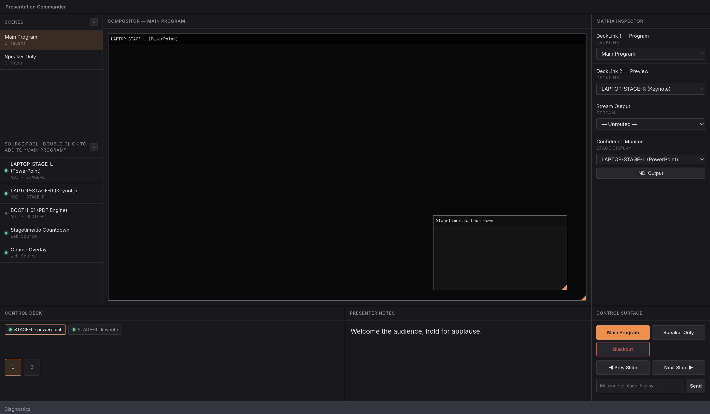
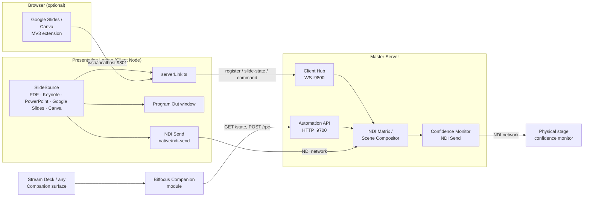

# Presentation Commander — Server

> **AI-assisted project.** This codebase was created with [Claude](https://claude.com/claude-code)
> (Anthropic), directed and reviewed by a human author. That covers the architecture, the
> implementation and the documentation. Check it over before you rely on it for a show.

The master control app for a live event: a real-time NDI video matrix router, a layered scene
compositor and a presenter-notes hub, built as an Electron + React + TypeScript desktop app.

It pairs with [presentation-commander-client](https://github.com/stoatworks-labs/presentation-commander-client),
the app that runs on each presentation laptop.

[](https://www.youtube.com/watch?v=sTzrCB5XlY8)

*A 43-second tour. It's the app itself the whole way through, recorded on screen and driven
over the automation API on `:9700`, which is the same endpoint the Companion module uses. It's
running on the demo data it ships with, and there's no presentation laptop paired to the server.*



<!-- downloads:start -->

## Download

**[v1.1.4](https://github.com/stoatworks-labs/presentation-commander-server/releases/tag/v1.1.4)** — prebuilt for macOS, Windows and Linux. Pick your platform:

<details>
<summary><b>macOS</b> — Apple Silicon, Intel</summary>

| Build | Download | Size |
| --- | --- | --- |
| Apple Silicon · .dmg disk image | [`presentation-commander-server-1.1.4-arm64.dmg`](https://github.com/stoatworks-labs/presentation-commander-server/releases/download/v1.1.4/presentation-commander-server-1.1.4-arm64.dmg) | 149 MB |
| Intel · .dmg disk image | [`presentation-commander-server-1.1.4-x64.dmg`](https://github.com/stoatworks-labs/presentation-commander-server/releases/download/v1.1.4/presentation-commander-server-1.1.4-x64.dmg) | 156 MB |
| Apple Silicon · .pkg installer | [`presentation-commander-server-1.1.4-macos-arm64.pkg`](https://github.com/stoatworks-labs/presentation-commander-server/releases/download/v1.1.4/presentation-commander-server-1.1.4-macos-arm64.pkg) | 149 MB |
| Intel · .pkg installer | [`presentation-commander-server-1.1.4-macos-x64.pkg`](https://github.com/stoatworks-labs/presentation-commander-server/releases/download/v1.1.4/presentation-commander-server-1.1.4-macos-x64.pkg) | 156 MB |
| Apple Silicon · .zip archive | [`Presentation.Commander.Server-1.1.4-arm64-mac.zip`](https://github.com/stoatworks-labs/presentation-commander-server/releases/download/v1.1.4/Presentation.Commander.Server-1.1.4-arm64-mac.zip) | 149 MB |
| Intel · .zip archive | [`Presentation.Commander.Server-1.1.4-mac.zip`](https://github.com/stoatworks-labs/presentation-commander-server/releases/download/v1.1.4/Presentation.Commander.Server-1.1.4-mac.zip) | 156 MB |

</details>

<details>
<summary><b>Windows</b> — x64</summary>

| Build | Download | Size |
| --- | --- | --- |
| x64 · .exe installer | [`presentation-commander-server-1.1.4-x64-setup.exe`](https://github.com/stoatworks-labs/presentation-commander-server/releases/download/v1.1.4/presentation-commander-server-1.1.4-x64-setup.exe) | 131 MB |
| x64 · portable .exe | [`presentation-commander-server-1.1.4-x64-portable.exe`](https://github.com/stoatworks-labs/presentation-commander-server/releases/download/v1.1.4/presentation-commander-server-1.1.4-x64-portable.exe) | 131 MB |
| .zip archive | [`Presentation.Commander.Server-1.1.4-win.zip`](https://github.com/stoatworks-labs/presentation-commander-server/releases/download/v1.1.4/Presentation.Commander.Server-1.1.4-win.zip) | 170 MB |

</details>

<details>
<summary><b>Linux</b> — x64</summary>

| Build | Download | Size |
| --- | --- | --- |
| x64 · .deb package (Debian/Ubuntu) | [`presentation-commander-server_1.1.4_amd64.deb`](https://github.com/stoatworks-labs/presentation-commander-server/releases/download/v1.1.4/presentation-commander-server_1.1.4_amd64.deb) | 118 MB |
| x64 · .rpm package (Fedora/RHEL) | [`presentation-commander-server-1.1.4.x86_64.rpm`](https://github.com/stoatworks-labs/presentation-commander-server/releases/download/v1.1.4/presentation-commander-server-1.1.4.x86_64.rpm) | 94 MB |
| x64 · AppImage | [`presentation-commander-server-1.1.4-x86_64.AppImage`](https://github.com/stoatworks-labs/presentation-commander-server/releases/download/v1.1.4/presentation-commander-server-1.1.4-x86_64.AppImage) | 144 MB |

</details>

All builds, checksums and release notes: [github.com/stoatworks-labs/presentation-commander-server/releases](https://github.com/stoatworks-labs/presentation-commander-server/releases).

macOS builds are signed and notarised and open normally. The Windows builds are unsigned, so SmartScreen warns once — see [Windows SmartScreen & Defender Firewall](#windows-smartscreen--defender-firewall) for the one-time click-through.

<!-- downloads:end -->

## What it does

- **Source Pool:** add, edit and delete NDI and web sources, or pick an actual NDI
  sender it's found on the network (mDNS `_ndi._tcp.local`).
- **Scenes:** a layered scene compositor. Build scenes from several layered sources, drag
  to reposition, drag a corner to resize, and toggle visibility. Layers backed by a real
  network source show a **live video preview** rendered from the NDI frames coming in,
  not a placeholder box.
- **Matrix Inspector:** route any physical/stream/stage output to a source or a full
  composited scene.
- **Control Deck:** live presenter notes and slide position for each connected Client Node.
- **Control Surface:** a grid of buttons for scene recall, blackout, next/previous slide
  and send-note-to-stage, all going through the same command path as the JSON-RPC
  automation API (`:9700`), which also drives the
  [Bitfocus Companion module](https://github.com/stoatworks-labs/companion-module-presentationcommander-server)
  for Stream Deck.
- **Confidence Monitor:** a `Presenter Notes` source type composites live presenter
  notes over video into one proper NDI output (`native/ndi-send`, the same addon
  architecture as the Client's NDI send), so a physical stage monitor gets an actual
  broadcast signal rather than a text box in the operator's own window.
- **Client Hub** (`:9800`): a WebSocket server that Client Nodes register with. Connected
  clients turn up as routable sources on their own, and next/previous-slide commands are
  passed on live to the client instead of being faked locally.

## Architecture



## What's real vs. mocked

NDI **discovery and receive are real**, built directly against the official
[Vizrt NDI SDK](https://ndi.video/for-developers/ndi-sdk/) through a small
native N-API addon (`native/ndi-receive`), with no third-party NDI wrapper.
Source discovery uses mDNS, and the scene compositor's layer previews are
actual decoded video frames pulled off the network with
`NDIlib_recv_capture_v3`. DeckLink capture cards and other physical
broadcast hardware are still out of scope, because I've no way to test
against hardware I haven't got.

### Building from source

The native receive addon links against the NDI SDK at build time. Install
the [NDI SDK](https://ndi.video/for-developers/ndi-sdk/) first (macOS
default: `/Library/NDI SDK for Apple`; set `NDI_SDK_DIR` if yours lives
somewhere else). `npm install` rebuilds the addon automatically via
`@electron/rebuild`.

## Documentation

| Doc | Contents |
|---|---|
| [docs/USER-GUIDE.md](docs/USER-GUIDE.md) | Operating it: sources, scenes, routing, client nodes, troubleshooting — and what is real vs. mocked |
| [docs/API.md](docs/API.md) | Automation API (`:9700`), Client Hub protocol (`:9800`), domain model, IPC channels |
| [docs/DEVELOPING.md](docs/DEVELOPING.md) | Setup, the NDI SDK build dependency, packaging traps, architecture |

Two things worth knowing before a show, both covered in the user guide: **nothing is
saved** (quitting throws away every source, scene and route), and the app starts with
**demo data** that looks like a configured rig but isn't.

## Roadmap / TODO

- [ ] **Physical capture hardware:** DeckLink capture cards and other broadcast I/O are out of scope for now, as I've no way to test against hardware I haven't got. NDI discovery/receive and the compositor are real (see "What's real vs. mocked" above).

## Project Setup

### Install

```bash
npm install
```

### Development

```bash
npm run dev
```

### Build

```bash
# Windows
npm run build:win

# macOS
npm run build:mac

# Linux
npm run build:linux
```

## Windows SmartScreen & Defender Firewall

macOS builds are **Developer ID-signed and notarised by Apple**, so they open
normally, with no Gatekeeper warning and no quarantine step. The Windows
binaries **aren't** code-signed, so Windows still warns you the first time.

- **Windows:** SmartScreen shows *"Windows protected your PC"* →
  **More info** → **Run anyway**.
- **Windows Defender Firewall:** the first launch pops up *"Allow Presentation Commander
  Server to communicate on these networks"*. Tick **Private** (and **Domain** on a
  managed network). Presentation Commander Server needs it to serve its JSON-RPC
  control API and route NDI video. Deny it and clients, Companion and the automation API
  will all fail to connect.
- **Linux:** no signing gate.

Per-artifact steps, self-signing, checksum verification and the Defender Firewall reset
procedure: **[docs/UNSIGNED.md](docs/UNSIGNED.md)**.

## Recommended IDE Setup

- [VSCode](https://code.visualstudio.com/) + [ESLint](https://marketplace.visualstudio.com/items?itemName=dbaeumer.vscode-eslint) + [Prettier](https://marketplace.visualstudio.com/items?itemName=esbenp.prettier-vscode)

## Trademarks and third-party licences

**NDI® is a registered trademark of Vizrt NDI AB.** See <https://ndi.video>.
This project is not affiliated with or endorsed by Vizrt.

The NDI runtime is obtained separately under Vizrt's own terms and is not
redistributed here. NDI Tools are not redistributed either — get them from
<https://ndi.video/tools>.

H.264, H.265 and AAC are separately licensable formats. The NDI SDK grant does
not cover them, and the obligation sits with whoever ships a product using them.

<!-- attributions:start -->
This project is built on other people's work — see [ATTRIBUTIONS.md](ATTRIBUTIONS.md).
<!-- attributions:end -->
